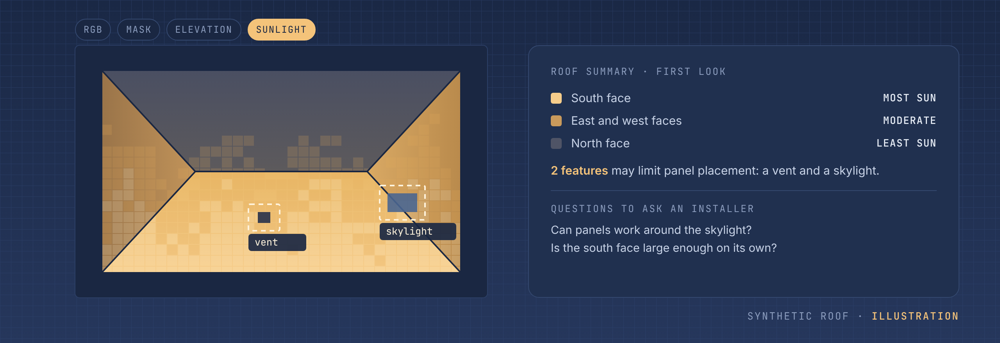
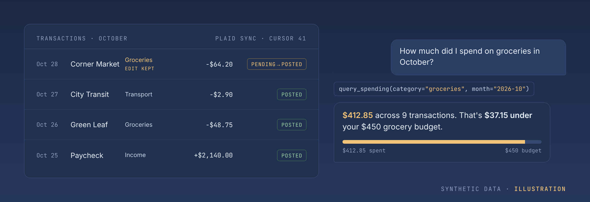
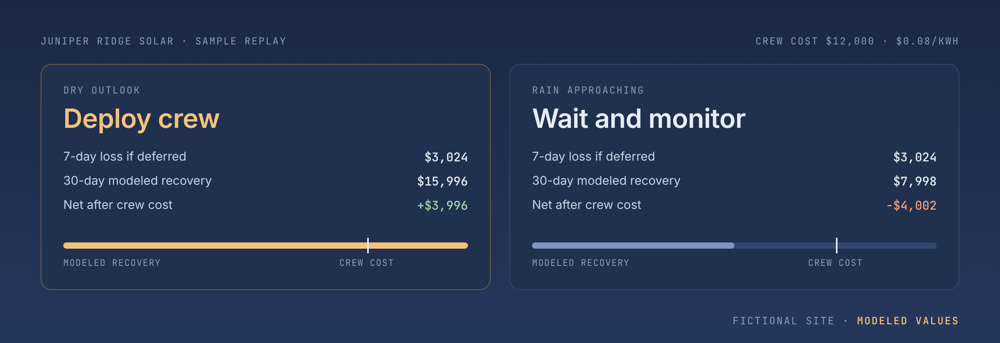

# Jitthen Kumarr

I'm an applied AI engineer who builds products end to end, from defining the problem and choosing an approach to shipping and refining the software. I work across the full stack and take ownership of the details that make a product reliable and useful.

[Personal website](https://jitthenkumarr.com) · [LinkedIn](https://www.linkedin.com/in/jitthenkumarr/)

## Selected work

### MySolarRoof

Homeowners considering solar often need a basic answer before they know what to ask an installer. My master's project gives them a first look at how much sun different parts of their roof get, where features like vents or skylights might limit panel placement, and what questions to ask next.

`Next.js` · `TypeScript` · `OpenAI Responses API` · `LangChain` · `Google Solar API`

Master's project in progress. Private repository. The illustration uses a synthetic roof.

### Expense Tracker

There are plenty of expense trackers on the market. I built my own because I wanted a lower-cost way to track spending and budgets, and I wanted to understand the architecture behind those tools from end to end. It gives me one place to see where my money went, compare spending with my budget, and ask questions like “How much did I spend on groceries last month?”

`React` · `TypeScript` · `FastAPI` · `PostgreSQL` · `LangGraph` · `Plaid`

Private repository. The illustration uses synthetic data.

### [Solar Soiling Decision Support](https://github.com/jkumarr10/veris-hackathon)

This Veris hackathon prototype helps solar operators decide when a cleaning visit is worth the cost. It uses generation and weather data to recommend dispatching a crew, monitoring the site, or raising an alert.

- The recommendation shows the cost of sending a crew alongside the estimated value of recovered generation.
- The backend checks the recommended action against weather and cost rules. Rain in the forecast raises the threshold for sending a crew.
- The estimate uses a generation shortfall as a proxy for soiling. Other site conditions can also reduce output.

`Python` · `FastAPI` · `React`

The illustration shows two weather scenarios from the local replay prototype.

## Currently building

I'm working on a prototype to help people spot and track scam calls, including suspected deepfake voice impersonation. It flags warning signs during a call and gives the user a summary to review afterward.

`TypeScript` · `React` · `Gemini`

## Experience

**AI Engineer (contract), Pinnacle Consulting** · Nov 2024–Feb 2026 
I built Python workflows to extract and verify information from financial statements and reports. I used SAP HANA semantic search and OpenAI models to match references to the same entity across documents, and packaged the Flask APIs in Docker.

**AI Engineer (contract), Publicus** · Jul–Nov 2024 
I worked on an assistant that helps people find housing, childcare, and healthcare services. I built query expansion and retrieval workflows, evaluated the results, and deployed Python functions on AWS Lambda.

**Account Manager, Teleperformance (Google Ads program)** 
I was the point of contact for 30 e-commerce and agency clients. I worked with them to identify performance problems, demoed platform features, and turned campaign data into recommendations their teams could act on. I also brought recurring customer feedback back to the product team.

**Project Coordinator, Plan Group** 
I coordinated construction projects across teams, tracking schedules, budgets, and milestones from planning through completion.

## Also

- [MCP in Python](https://github.com/jkumarr10/mcp-python-tutorial) walks through how an MCP host, client, and server fit together.
- [LinkedIn Drafting Agent](https://github.com/jkumarr10/linkedin_agent) is a Streamlit app for drafting and reviewing LinkedIn posts using the OpenAI Agents SDK.

Python · TypeScript · SQL · FastAPI · React · Next.js · LangChain · LangGraph · PostgreSQL · Azure · AWS · Docker
